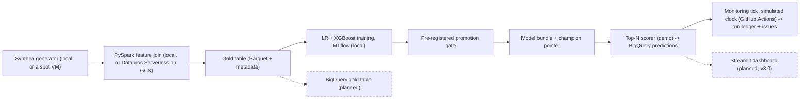
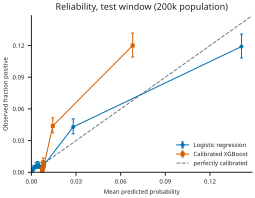

# synthea-readmission-risk

[](https://github.com/fma00/synthea-readmission-risk/actions/workflows/ci.yml) [](LICENSE) [](.python-version) [](https://github.com/fma00/synthea-readmission-risk/actions/workflows/monitor.yml) [](https://github.com/fma00/synthea-readmission-risk/blob/ledger/docs/run-ledger.md)

An end-to-end, tested pipeline for predicting **unplanned** 30-day hospital readmission from [Synthea](https://synthea.mitre.org/)-generated synthetic patient data. A PySpark job joins ten Synthea tables into a per-encounter feature table and an explicit planned-versus-unplanned readmission label; a leakage-controlled training pipeline — chronological, patient-disjoint split with a censoring buffer and a label-window purge — fits a logistic regression baseline and a calibrated XGBoost challenger, both tracked in MLflow; and a Top-N triage CLI ranks held-out discharges behind a set of provenance guards that refuse any model/data mismatch. In v2 the same feature job runs on Dataproc Serverless over a 200,000-patient population, a pre-registered promotion gate decides whether a retrained model replaces the champion, and a scheduled monitoring tick on a simulated clock scores each week and checks calibration once labels mature.

> [!NOTE]
> **Work in progress.**
>
> - **Built:** the local pipeline, models and demo scorer (v1); in v2 also the cloud setup on GCP (Terraform, keyless CI identity, Dataproc Serverless, scoring into BigQuery), the 200,000-patient scale-up, a pre-registered promotion gate, and a monitoring tick on a simulated clock with a run ledger.
> - **Not built yet:** the dashboard and the BigQuery gold table (planned for v3.0) — see the [Roadmap](#roadmap).
> - **Limits:** synthetic data; the v1 numbers are a development set; on the v2 validation the models do not beat a no-model lookup — see [Limitations](#limitations).
> - **Release:** the [latest release](https://github.com/fma00/synthea-readmission-risk/releases/latest) is **v2.0** (cloud, scale-up, monitoring), tagged after metric M3 was met (a dispatched burn-in, then a scheduled weekly tick); v1.0 and v1.1 were the local-only milestone.
> - **Read next:** [Status](#status) · [Results so far](#results-so-far) · [Limitations](#limitations) · [Roadmap](#roadmap)

## Status

| Slice | Stage | Status |
|---|---|---|
| 1 | [Local Synthea generation](notes/eg-new-feature/local-synthea-generation-2026-09-16.md) | Done |
| 2 | [PySpark multi-table join (feature engineering)](notes/eg-new-feature/pyspark-big-join-2026-09-19.md) | Done |
| 2b | [Unplanned-readmission label and gold-table provenance](notes/eg-new-feature/readmission-label-planned-exclusion-2026-09-20.md) | Done |
| 3 | [Logistic regression and calibrated XGBoost, tracked in MLflow](notes/eg-new-feature/model-training-2026-09-19.md) ([results](docs/results.md)) | Done |
| 4 | [Top-N triage CLI (a demo over held-out rows)](notes/eg-new-feature/batch-scoring-cli-2026-09-20.md) ([usage](docs/scoring.md)) | Done |
| v2 | **Cloud**: Terraform-managed GCS and IAM, keyless GitHub Actions identity, Big Join on Dataproc Serverless, scoring into BigQuery with data tests ([setup](docs/setup.md)) | Done in v2.0 |
| v2 | **Scale-up**: 200,000 patients with a fresh seed, pre-registered, and a promotion gate ([results](docs/results.md)) | Done in v2.0 |
| v2 | **Monitoring**: weekly delayed-label calibration check on a simulated clock, run ledger, failure issues ([design](notes/eg-new-feature/v2-slice7-monitoring-tick-ledger-2026-10-18.md), [ledger](https://github.com/fma00/synthea-readmission-risk/blob/ledger/docs/run-ledger.md)) | Done in v2.0 |
| v3 | **Dashboard**: Streamlit on BigQuery, and the BigQuery gold table | Planned for v3.0 (not started) |

## 60-second tour

An MLOps overview in eight stops: each a file to open and what to look for in it.

1. **The label:** [`flag_inpatient_stays` and `build_index_encounters`](src/readmission_risk/pipeline/big_join.py) define an *unplanned* 30-day readmission: planned chemotherapy/radiation stays and overlapping surgical episodes do not count, and a stay whose outcome window cannot be observed is dropped rather than labelled 0.
2. **Provenance:** [gold_metadata.py](src/readmission_risk/pipeline/gold_metadata.py) writes `_gold_metadata.json` next to every gold table; training refuses a table without it or with mismatched settings.
3. **The split:** [`chronological_group_split`](src/readmission_risk/models/split.py) is chronological and patient-disjoint, with a censoring buffer, a label-window purge and a label-horizon purge; [test_split.py](tests/models/test_split.py) pins each rule.
4. **Honest evaluation:** [evaluate.py](src/readmission_risk/models/evaluate.py) and [baselines.py](src/readmission_risk/models/baselines.py) report calibration (Brier score, ECE, reliability curve) next to AUC, with patient-clustered bootstrap intervals and a no-model lookup that the models do not beat ([results](docs/results.md)).
5. **Guarded scoring:** the scorer reads an immutable, content-addressed model bundle, never MLflow; [`validate_bundle`](src/readmission_risk/scoring/bundle_guard.py) verifies its hashes and runs 14 checks that refuse a mismatched model/data pair before anything is unpickled; [a real refusal](#what-a-refusal-looks-like) is shown below.
6. **Supply chain:** [requirements.txt](requirements.txt) is hash-locked, with a drift test against its `.in` file, and [ci.yml](.github/workflows/ci.yml) uses SHA-pinned actions, a zizmor audit, Python 3.14 tests plus a Dataproc-runtime job (Python 3.12, PySpark 4.0.2, Java 21) for the pipeline tests; local pre-commit hooks (ruff, zizmor, terraform fmt) mirror the lint.
7. **Pre-registered promotion (v2):** [prereg.yaml](prereg.yaml) fixed the rules before the validation population existed, an appended analysis lock fixed the challenger and the code before training, and [gate_run.py](src/readmission_risk/ops/gate_run.py) refuses to decide unless every one of them still holds; [gate.py](src/readmission_risk/models/gate.py) holds the rules.
8. **How it was designed:** [notes/](notes/) holds one design document per slice, each stress-tested by independent fresh-context reviewers; where a review did not close, the note says so (see [How this was built](#how-this-was-built)).

## Architecture

Full architecture rationale lives in [notes/prds/big-join-architecture-lock-in-2026-09-15.md](notes/prds/big-join-architecture-lock-in-2026-09-15.md) (v1) and [notes/prds/v2-mlops-keyless-scheduled-scale-up-2026-10-09.md](notes/prds/v2-mlops-keyless-scheduled-scale-up-2026-10-09.md) (v2); the standing architecture summary is in [CLAUDE.md](CLAUDE.md#architecture).



Solid boxes are built (the cloud parts run from the operator's laptop, the monitoring tick on GitHub Actions); dashed boxes are planned.

## Results so far

**v2, on a fresh 200,000-patient population: the reason-code lookup is at least as good as the models.** A logistic regression retrained at this scale beats the v1 champion on ROC-AUC but does not beat the no-model reason-code lookup, so the pre-registered promotion gate refuses. The rules, thresholds, challenger and code were committed before any model saw this population. The owner nevertheless promoted the retrained model afterwards, a disclosed override of that rule ("the champion is not replaced"), because the 10,000-patient population was a technical feasibility run and is too small to monitor ([PROMOTIONS.md](deploy/PROMOTIONS.md)); the finding above is unchanged.

| Test window (31,659 rows, 616 positives) | ROC-AUC | Brier score | Observed / expected |
|---|---|---|---|
| Challenger (the champion since slice 7, by override): logistic regression trained on `main_200k` | 0.872 | 0.0182 | 1.01 |
| Champion at the gate: v1 logistic regression (trained on the 10,000-patient v1 population) | 0.863 | 0.0181 | 1.11 |
| Reason-code lookup (no model, fitted on the same training rows) | 0.871 | 0.0184 | 0.96 |

Paired 95% intervals of the ROC-AUC difference (one-sided rule: the lower bound must be above 0): challenger − champion [+0.0012, +0.0172], challenger − lookup [−0.0033, +0.0060]. The v1 models, evaluated unchanged on the new population, meet their pre-registered acceptance criteria. Details, the frozen-v1 external validation and the caveats: [docs/results.md](docs/results.md).

<picture>
  <source media="(prefers-color-scheme: dark)" srcset="docs/img/v2/reliability_dark.svg">
  
</picture>

*Reliability of the 200k models on their test window (31,659 rows, 616 positives, 10 quantile bins). The logistic regression, now the champion, tracks the diagonal (top bin: predicted 0.141, observed 0.119); calibrated XGBoost under-predicts its highest bins. Wilson intervals treat rows as independent, so they understate the uncertainty. Regenerate with the command in [docs/results.md](docs/results.md#reliability-figure).*

### v1, on the 10,000-patient reference population (a development set)

Measured on the 10,000-patient Synthea reference population with the unplanned-readmission label: 6,391 training rows (96 positives) and 1,539 held-out test rows (**41 positives**); 95% patient-clustered bootstrap intervals are in the full write-up.

| Model | ROC-AUC | Brier score | Expected calibration error |
|---|---|---|---|
| Logistic regression | 0.869 [0.820, 0.919] | 0.0255 [0.0184, 0.0340] | 0.013 [0.008, 0.023] |
| Calibrated XGBoost | 0.823 [0.751, 0.884] | 0.0257 [0.0181, 0.0347] | 0.018 [0.013, 0.029] |
| Reason-code-only lookup (reference, no model; `readmission_risk.models.baselines.reason_code_lookup`) | 0.873 | 0.0252 | 0.012 |

<picture>
  <source media="(prefers-color-scheme: dark)" srcset="docs/img/reliability_dark.svg">
  
</picture>

*v1 models (the champion until slice 7). Reliability on the test window (a development set): 10 quantile bins, 41 positives in total. Vertical bars are 95% Wilson intervals with rows treated as independent, so they understate the uncertainty. In the upper bins the observed rate exceeds the predicted one, consistent with the under-prediction described below. Regenerate with the command in [docs/results.md](docs/results.md#reliability-figure).*

- **A reason-code-only baseline matches or beats both models.** The lookup (a per-admission-reason rate table, no patient features) scores 0.873 ROC-AUC; its paired differences with logistic regression include zero, and calibrated XGBoost is worse than the lookup.
- **The models barely beat the base rate.** Brier skill scores against the training prevalence are 0.022 (logistic regression) and 0.014 (XGBoost), and XGBoost is worse than logistic regression on ROC-AUC (paired −0.047 [−0.092, −0.010]).
- **Small sample.** 41 test positives is below the trainer's own 50-positive reliability threshold, so `train_models.py` prints an "unreliable" warning on this run by design, and the intervals are wide.
- **The positive rate shifts** between train and test (1.50% vs 2.66%), and both models under-predict on average.
- **Not a virgin holdout.** The cutoff date, the features and the label rule were chosen while looking at this test window, so read these as development-set numbers; the untouched validation is the v2 result above.
- **More data mainly buys precision.** With the larger population an ROC-AUC of about 0.87–0.90 was *expected*, consistent with Synthea generating these events from scripted pathways; v2 measured 0.872 for the retrained model and 0.871 for the lookup.

Full tables, paired intervals, how the label was built and the remaining caveats: [docs/results.md](docs/results.md).

## Example output

What the Top-N triage CLI produces with the champion (the logistic regression trained on the 200,000-patient population): the first five rows of one ranked batch (the full batch is written to a Parquet file by [scripts/score_discharges.py](scripts/score_discharges.py); usage in [docs/scoring.md](docs/scoring.md)).

Sample Top-5: ranks 1-5 of 675 discharges scored in the 30-day window ending 2025-06-30, Logistic regression. Demo over held-out rows (200k population), not new-data scoring.
Risk scores are rankings, not absolute risks: the test-window prevalence is 1.95% (616 of 31,659) and the models under-predict on average.

| Rank | Risk score | Discharged | Admission reason | Patient |
|---:|---:|---|---|---|
| 1 | 0.6382 | 2025-06-21 | Aortic valve regurgitation (disorder) | 7c42435e |
| 2 | 0.5560 | 2025-06-26 | Aortic valve stenosis (disorder) | e16c9837 |
| 3 | 0.3665 | 2025-06-17 | Aortic valve stenosis (disorder) | 8c0de04a |
| 4 | 0.3663 | 2025-06-27 | Aortic valve stenosis (disorder) | b206db03 |
| 5 | 0.3594 | 2025-06-04 | Aortic valve stenosis (disorder) | b2f68c20 |

Patient ids are synthetic and shortened to eight characters. The table is generated by [scripts/make_readme_assets.py](scripts/make_readme_assets.py) from the saved predictions of the same logistic-regression run that the v2 figure above uses.

### What a refusal looks like

Asking for a window of training-period discharges is refused rather than silently scored (exit code 1, nothing written):

```console
$ python scripts/score_discharges.py --gold-dir data/gold/main_200k --run-date 20220630
ERROR: window [2022-06-01T00:00:00+00:00, 2022-07-01T00:00:00+00:00) contains 471 in-sample (training-partition) discharge(s) and 192 discharge(s) excluded by the split (neither partition); a held-out Top-N list needs every discharge in the window to be a held-out row
```

In the same way, the integrity checks and 14 guards in [`validate_bundle`](src/readmission_risk/scoring/bundle_guard.py) refuse a tampered bundle, or a model trained on a different gold table (the same command on the 10,000-patient table is refused by the fingerprint guard: "the model was not trained on this table"), label definition, library version or Python version, before it is unpickled; [docs/scoring.md](docs/scoring.md) lists every refusal. The command scores with the committed champion bundle (`deploy/champion.json`, in a private bucket since v2 slice 4, so it needs the author's credentials); on a fresh clone, train, export and score your own bundle offline with `--bundle bundles/<id>`, as [docs/scoring.md](docs/scoring.md#model-bundles) describes. The two frozen v1 models also exist as schema-2 bundles that carry a portable (non-pickle) form, which reproduces them exactly (maximum absolute difference 0) on every platform measured; a stored reference lets that be re-checked without the pickle, bit-exactly on macOS (on Linux the platform itself changes the last bits, see [docs/scoring.md](docs/scoring.md#model-bundles)).

## Limitations

- Synthetic data, not clinical evidence — see [About the data](#about-the-data).
- The models do not beat a no-model reason-code lookup: on the pre-registered v2 validation (616 test positives) the retrained model is not shown to rank better than it — [details](docs/results.md).
- The v1 numbers are a small-sample development set (41 test positives; design choices were made while looking at that test window) — [details](docs/results.md).
- The label/test leakage margin is enforced: training rows whose label depends on a record dated on or after the test start are purged (0 rows on this data; the closest record is about 6.9 days before it) — [details](docs/results.md).
- The label is still reason-concentrated (one admission reason dominates the test positives) — [details](docs/results.md).
- The scorer is a demo over held-out rows, not as-of scoring of new discharges — [details](docs/scoring.md).
- The champion was promoted by a disclosed override of the pre-registered gate, and its test window has now been used by the gate and by monitoring, so no untouched validation population is left — [PROMOTIONS.md](deploy/PROMOTIONS.md).
- Monitoring replays held-out discharges on a simulated clock, from a gold table built with hindsight: it demonstrates the mechanics (repeatability, idempotency, alerts and issues), not live calibration or weeks of unattended operation; the burn-in was dispatched every 30 minutes by a timer on the owner's laptop (done 2026-10-21), because GitHub's scheduler dropped most accelerated slots; the 'Monitoring tick (scheduled)' badge shows the latest scheduled run, which can lag and, with the weekly retry slots, can be a slot that skipped (green even after a week whose 3 attempts failed), so the last-tick badge and the ledger are the record of each week's tick — [design](notes/eg-new-feature/v2-slice7-monitoring-tick-ledger-2026-10-18.md), [amendment](notes/eg-new-feature/monitoring-burn-in-timer-and-weekly-retry-2026-10-20.md).
- The cloud set-up and the catch-up of the first monitoring weeks run from the operator's laptop; the dashboard is not built yet — see the [Roadmap](#roadmap).
- One label definition, and two Synthea populations (v1 and the v2 validation) — see the [Roadmap](#roadmap).

## About the data

**Data-realism note:** Synthea is a synthetic patient generator, not real-world data. Notable limitations relevant to this project: it codes conditions in SNOMED-CT rather than ICD-10-CM, its disease modules are largely isolated from one another (limited comorbidity interaction), coverage is concentrated in a few dozen well-modeled conditions, it does not model hospital resource capacity, and it lacks the messiness (missing values, coding errors, inconsistent documentation) of real clinical data. Treat model performance here as a demonstration of the pipeline and methodology, not a clinically validated result.

## Roadmap

Items 1-3 make up v2.0 (tagged after metric M3 was met on 2026-10-26: a dispatched burn-in, then a scheduled weekly tick); item 4 moved to v3.0 (owner decision 2026-10-18); the v1 releases (v1.0, then v1.1 with the post-release hardening) are the local-only milestone. Full requirements: the [v2 PRD](notes/prds/v2-mlops-keyless-scheduled-scale-up-2026-10-09.md).

1. **Cloud (done in v2.0):** billing alerts, Terraform-managed GCS buckets and service accounts, a keyless GitHub Actions identity (Workload Identity Federation), the PySpark job on Dataproc Serverless reading and writing GCS, and scoring into BigQuery behind SQL data tests. The BigQuery gold table via the direct write method (Storage Write API) moved to v3.0.
2. **Scale-up (done in v2.0):** a 200,000-patient population with a new seed and fresh `reference_date` as the untouched validation, pre-registered before it was generated (616 test positives); a retrained model went through a pre-registered promotion gate and was refused because it does not beat the reason-code lookup ([results](docs/results.md)), then promoted by a disclosed owner override ([PROMOTIONS.md](deploy/PROMOTIONS.md)).
3. **Monitoring (done in v2.0):** a tick on a simulated clock (scheduled weekly; the burn-in dispatched by a laptop timer) scores each simulated week into BigQuery and checks observed-versus-expected calibration on the 13-week cohort whose labels have matured, under the pre-registered rule; a run ledger on the [`ledger` branch](https://github.com/fma00/synthea-readmission-risk/blob/ledger/docs/run-ledger.md), and one GitHub issue per failure or alert. It is not weeks of unattended operation: an accelerated burn-in dispatched by a laptop timer, then a scheduled weekly cadence ([runbook](docs/setup.md#monitoring-tick-v2-slice-7)).
4. **Dashboard (v3.0, not started):** a Streamlit dashboard reading BigQuery (Streamlit Community Cloud first, Cloud Run later), with a live "stale since" heartbeat, the model card and the BigQuery gold table.
5. **Smaller follow-ups:** label v2, as-of scoring, hyperparameter tuning, feature attribution, hosted MLflow.

## What this shows

| Role | What the repo shows | Where |
|---|---|---|
| Data engineering | Schema-first PySpark join (hand-declared `StructType`, no `inferSchema`), planned-stay and continuation logic, gold-table provenance metadata, hash-pinned lockfiles, CI | [big_join.py](src/readmission_risk/pipeline/big_join.py), [schemas.py](src/readmission_risk/pipeline/schemas.py), [gold_metadata.py](src/readmission_risk/pipeline/gold_metadata.py), [requirements.txt](requirements.txt), [ci.yml](.github/workflows/ci.yml) |
| Data science | Chronological, patient-disjoint split with a censoring buffer and a label-window purge; label-definition work; calibration metrics; clustered-bootstrap intervals; a no-model baseline; an honest weak result | [split.py](src/readmission_risk/models/split.py), [evaluate.py](src/readmission_risk/models/evaluate.py), [baselines.py](src/readmission_risk/models/baselines.py), [results](docs/results.md) |
| ML engineering | MLflow tracking; manifest-checked model bundles (14 guards + integrity checks) and a champion pointer; idempotent, partitioned batch scoring with an injectable writer | [tracking.py](src/readmission_risk/models/tracking.py), [bundle_export.py](src/readmission_risk/models/bundle_export.py), [bundle_guard.py](src/readmission_risk/scoring/bundle_guard.py), [pipeline.py](src/readmission_risk/scoring/pipeline.py), [score_discharges.py](scripts/score_discharges.py) |
| MLOps (v2) | Terraform with least-privilege service accounts and keyless CI identity; Dataproc Serverless runs; write-audit-publish into BigQuery with SQL data tests; pre-registration, an analysis lock and a promotion gate that refuses on any drift; a scheduled, idempotent monitoring tick with a run ledger and failure issues | [infra/](infra/), [score.yml](.github/workflows/score.yml), [monitor.yml](.github/workflows/monitor.yml), [monitoring/](src/readmission_risk/monitoring/), [warehouse/](src/readmission_risk/warehouse/), [prereg.yaml](prereg.yaml), [gate_run.py](src/readmission_risk/ops/gate_run.py) |

## Quick start

```sh
python3.14 -m venv .venv
source .venv/bin/activate
pip install -e .
pip install --require-hashes -r requirements.txt -r requirements-linux-extras.txt
pip install --require-hashes -r requirements-dev.txt
ruff check . && pytest
```

Needs a JDK 17+ on `PATH` (PySpark local mode) and, on macOS, `brew install libomp` (XGBoost). The tests need no downloaded data. The full pipeline (Synthea generation, feature join, training, scoring) is in [docs/setup.md](docs/setup.md) and [docs/scoring.md](docs/scoring.md).

### Running it

`make help` lists every target; variables can be overridden (`make score RUN_DATE=20240115`). Two groups:

| Step | Command | Needs |
|---|---|---|
| Lint and test | `make lint`, `make test` | nothing beyond Quick start |
| Generate a population and build the gold table | `./scripts/setup_synthea.sh`, then the commands in [setup.md](docs/setup.md#running-the-actual-pipeline-slice-1-synthea-generation) | a JDK, about 8 GB of disk for 10,000 patients |
| Train both models (MLflow) | `make train TRAIN_EXPERIMENT=<name>` | a gold table |
| Export a model bundle | `make export EXPERIMENT=<name>` | a trained experiment |
| Score a Top-N list | `make score SCORE_GOLD_DIR=<gold> SCORE_ARGS="--bundle bundles/<id>"` | a bundle and its gold ([scoring.md](docs/scoring.md)) |
| Check the monitoring range, simulate it | `make monitor-preflight`, `make monitor-simulate` | the champion bundle and gold (owner) |
| Score into BigQuery, prove the data tests | `make score-bq RUN_DATE=…`, `make m5-check`, `make m5-monitoring` | owner: GCP credentials |
| Run the monitoring tick | `gh workflow run monitor.yml --ref main` (dispatched by a laptop timer during the burn-in, `make burn-in-timer`; scheduled weekly, with hourly retry slots Monday to Wednesday); `make monitor-catch-up WEEKS=…` from the laptop | owner: GCP and GitHub ([runbook](docs/setup.md#monitoring-tick-v2-slice-7)) |
| Ledger and metric M3 | `make ledger`, `make m3-check` | owner: GCP and `gh` |

Without the author's credentials, everything in the first five rows works on a fresh clone; the cloud steps document the author's setup and need your own GCP project and Terraform apply ([setup.md](docs/setup.md#infrastructure-terraform)).

## How this was built

Developed with Claude Code (Anthropic's coding agent) under a design-first workflow inspired by [Elephants, Goldfish, and the New Golden Age of Software Engineering](https://drensin.medium.com/elephants-goldfish-and-the-new-golden-age-of-software-engineering-c33641a48874). Claude drafted the code, tests and documents; the project owner set the goals and made the decisions recorded in `notes/`. Designs and diffs went through independent fresh-context reviewer passes; where a pass did not close, the notes say so and record the owner's decision to proceed. Commits carry a `Co-Authored-By` trailer.

The workflow lives in [.claude/commands/](.claude/commands/) and [CLAUDE.md](CLAUDE.md). Four notes show the trail: the [architecture PRD](notes/prds/big-join-architecture-lock-in-2026-09-15.md), the [model-training design](notes/eg-new-feature/model-training-2026-09-19.md), the [label design](notes/eg-new-feature/readmission-label-planned-exclusion-2026-09-20.md) and the [batch-scoring design](notes/eg-new-feature/batch-scoring-cli-2026-09-20.md); for v2, the [v2 PRD](notes/prds/v2-mlops-keyless-scheduled-scale-up-2026-10-09.md), the [promotion-gate design](notes/eg-new-feature/v2-slice6b-promotion-gate-frozen-v1-2026-10-16.md) and the [monitoring-tick design](notes/eg-new-feature/v2-slice7-monitoring-tick-ledger-2026-10-18.md).

Commands to regenerate the data and re-derive the reported numbers are given in [docs/setup.md](docs/setup.md), [docs/results.md](docs/results.md) and the [measurements note](notes/eg-new-feature/readmission-label-planned-exclusion-2026-09-20-measurements.md); a bit-exact regeneration from the same seed has not been verified, and the MLflow store is local and not published. Notes are dated historical records and may cite the README as it was at the time.

## Repository layout

```
src/readmission_risk/pipeline/  # Synthea generation wrapper, PySpark feature join, gold-table metadata
src/readmission_risk/models/    # split, features, training, evaluation, MLflow tracking
src/readmission_risk/scoring/   # Top-N triage scorer (pure functions)
src/readmission_risk/reporting/  # README figure and sample table, built from MLflow runs and a predictions file
src/readmission_risk/bundles/   # model bundle format: manifest, local store, champion pointer
src/readmission_risk/portable/  # portable (non-pickle) form of the frozen v1 models: predictor, one-time export
src/readmission_risk/warehouse/ # BigQuery: staging, SQL data tests, publish into serving tables
src/readmission_risk/monitoring/ # monitoring tick: simulated clock, pre-registered O/E rule, cohorts, ledger
src/readmission_risk/ops/       # laptop CLIs for the cloud runs, population checks, the promotion gate
prereg.yaml                     # the pre-registration: rules (Phase A), analysis lock, results (Phase B)
deploy/champion.json            # the live model bundle (promotion = a PR editing it)
deploy/PROMOTIONS.md            # append-only log of every champion change (incl. the 200k override)
deploy/monitoring.json          # what the monitoring tick monitors, and its simulated-clock range
scripts/                        # command-line entry points
tests/                          # pytest suite (tests/test_docs.py covers these docs)
docs/                           # setup, results and scoring write-ups
infra/                          # Terraform: buckets, service accounts, WIF, budgets; applied from a laptop, validated in CI
notes/                          # design docs, PRDs, measurements (dated records)
.claude/commands/               # the /eg-* design-review workflow
.github/workflows/              # CI: ruff + pytest, a Dataproc-runtime pipeline job, a zizmor workflow audit and Terraform validation; dispatch-only keyless GCP smoke and scoring jobs; the monitoring tick (monitor.yml); actions pinned to commit SHAs
.github/dependabot.yml          # weekly update PRs for the pinned actions and the Terraform provider
Makefile                        # common tasks: setup, lint, test, train, export, score, runtime env, lockfiles, tf-validate, monitoring (make help)
.pre-commit-config.yaml         # ruff + zizmor git hooks (make hooks)
requirements-dataproc-3.0.txt   # hash-locked Dataproc runtime 3.0 mirror (CI's pipeline job only)
```

## License and acknowledgements

MIT, see [LICENSE](LICENSE). [Synthea](https://synthea.mitre.org/) (MITRE, Apache-2.0) is downloaded by [scripts/setup_synthea.sh](scripts/setup_synthea.sh) and is not redistributed.
