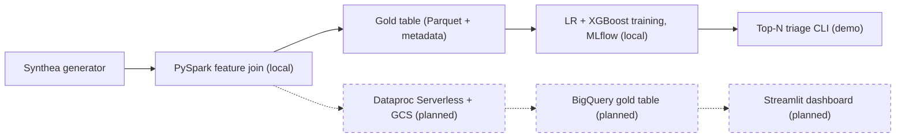
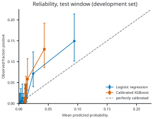

# synthea-readmission-risk

[](https://github.com/fma00/synthea-readmission-risk/actions/workflows/ci.yml) [](LICENSE) [](.python-version)

An end-to-end, tested pipeline for predicting **unplanned** 30-day hospital readmission from [Synthea](https://synthea.mitre.org/)-generated synthetic patient data. A PySpark job joins ten Synthea tables into a per-encounter feature table and an explicit planned-versus-unplanned readmission label; a leakage-controlled training pipeline — chronological, patient-disjoint split with a censoring buffer and a label-window purge — fits a logistic regression baseline and a calibrated XGBoost challenger, both tracked in MLflow; and a Top-N triage CLI ranks held-out discharges behind a set of provenance guards that refuse any model/data mismatch.

> [!NOTE]
> **Work in progress.**
>
> - **Built:** local pipeline, models and demo scorer, unit-tested.
> - **Not built yet:** cloud (GCP / BigQuery), scale-up and dashboard — see the [Roadmap](#roadmap).
> - **Limits:** synthetic data, small sample, development-set numbers — see [Limitations](#limitations).
> - **Release:** the [latest release](https://github.com/fma00/synthea-readmission-risk/releases/latest) is the local-only v1 milestone (everything marked Done below); the Planned items are v2 work, developed on the `v2` branch.
> - **Read next:** [Status](#status) · [Results so far](#results-so-far) · [Limitations](#limitations) · [Roadmap](#roadmap)

## Status

| Slice | Stage | Status |
|---|---|---|
| 1 | [Local Synthea generation](notes/eg-new-feature/local-synthea-generation-2026-09-16.md) | Done |
| 2 | [PySpark multi-table join (feature engineering)](notes/eg-new-feature/pyspark-big-join-2026-09-19.md) | Done |
| 2b | [Unplanned-readmission label and gold-table provenance](notes/eg-new-feature/readmission-label-planned-exclusion-2026-09-20.md) | Done |
| 3 | [Logistic regression and calibrated XGBoost, tracked in MLflow](notes/eg-new-feature/model-training-2026-09-19.md) ([results](docs/results.md)) | Done |
| 4 | [Top-N triage CLI (a demo over held-out rows)](notes/eg-new-feature/batch-scoring-cli-2026-09-20.md) ([usage](docs/scoring.md)) | Done |
| next | **Cloud**: GCS, Dataproc Serverless, BigQuery gold table | Planned (not started) |
| next | **Scale-up**: 100k-200k patients with a fresh seed | Planned (not started) |
| next | **Dashboard**: Streamlit on BigQuery | Planned (not started) |

## 60-second tour

For ML and MLOps reviewers: seven stops, each a file to open and what to look for in it.

1. **The label:** [`flag_inpatient_stays` and `build_index_encounters`](src/readmission_risk/pipeline/big_join.py) define an *unplanned* 30-day readmission: planned chemotherapy/radiation stays and overlapping surgical episodes do not count, and a stay whose outcome window cannot be observed is dropped rather than labelled 0.
2. **Provenance:** [gold_metadata.py](src/readmission_risk/pipeline/gold_metadata.py) writes `_gold_metadata.json` next to every gold table; training refuses a table without it or with mismatched settings.
3. **The split:** [`chronological_group_split`](src/readmission_risk/models/split.py) is chronological and patient-disjoint, with a censoring buffer, a label-window purge and a label-horizon purge; [test_split.py](tests/models/test_split.py) pins each rule.
4. **Honest evaluation:** [evaluate.py](src/readmission_risk/models/evaluate.py) and [baselines.py](src/readmission_risk/models/baselines.py) report calibration (Brier score, ECE, reliability curve) next to AUC, with patient-clustered bootstrap intervals and a no-model lookup that the models do not beat ([results](docs/results.md)).
5. **Guarded scoring:** [`validate_run`](src/readmission_risk/scoring/runs.py) runs 14 checks that refuse a mismatched model/data pair before anything is unpickled; [a real refusal](#what-a-refusal-looks-like) is shown below.
6. **Supply chain:** [requirements.txt](requirements.txt) is hash-locked, and [ci.yml](.github/workflows/ci.yml) uses SHA-pinned actions, a zizmor audit and a Python 3.12 + 3.14 matrix.
7. **How it was designed:** [notes/](notes/) holds one design document per slice, each stress-tested by independent fresh-context reviewers; where a review did not close, the note says so (see [How this was built](#how-this-was-built)).

## Architecture

Full architecture rationale lives in [notes/prds/big-join-architecture-lock-in-2026-09-15.md](notes/prds/big-join-architecture-lock-in-2026-09-15.md); the standing architecture summary is in [CLAUDE.md](CLAUDE.md#architecture).



Solid boxes are built; dashed boxes are planned.

## Results so far

Measured on the 10,000-patient Synthea reference population with the unplanned-readmission label: 6,391 training rows (96 positives) and 1,539 held-out test rows (**41 positives**); 95% patient-clustered bootstrap intervals are in the full write-up.

| Model | ROC-AUC | Brier score | Expected calibration error |
|---|---|---|---|
| Logistic regression | 0.869 [0.820, 0.919] | 0.0255 [0.0184, 0.0340] | 0.013 [0.008, 0.023] |
| Calibrated XGBoost | 0.823 [0.751, 0.884] | 0.0257 [0.0181, 0.0347] | 0.018 [0.013, 0.029] |
| Reason-code-only lookup (reference, no model; `readmission_risk.models.baselines.reason_code_lookup`) | 0.873 | 0.0252 | 0.012 |

<picture>
  <source media="(prefers-color-scheme: dark)" srcset="docs/img/reliability_dark.svg">
  
</picture>

*Reliability on the test window (a development set): 10 quantile bins, 41 positives in total. Vertical bars are 95% Wilson intervals with rows treated as independent, so they understate the uncertainty. In the upper bins the observed rate exceeds the predicted one, consistent with the under-prediction described below. Regenerate with the command in [docs/results.md](docs/results.md#reliability-figure).*

- **A reason-code-only baseline matches or beats both models.** The lookup (a per-admission-reason rate table, no patient features) scores 0.873 ROC-AUC; its paired differences with logistic regression include zero, and calibrated XGBoost is worse than the lookup.
- **The models barely beat the base rate.** Brier skill scores against the training prevalence are 0.022 (logistic regression) and 0.014 (XGBoost), and XGBoost is worse than logistic regression on ROC-AUC (paired −0.047 [−0.092, −0.010]).
- **Small sample.** 41 test positives is below the trainer's own 50-positive reliability threshold, so `train_models.py` prints an "unreliable" warning on this run by design, and the intervals are wide.
- **The positive rate shifts** between train and test (1.50% vs 2.66%), and both models under-predict on average.
- **Not a virgin holdout.** The cutoff date, the features and the label rule were chosen while looking at this test window, so read these as development-set numbers; the untouched validation is the planned larger population.
- **More data mainly buys precision.** With the larger population an ROC-AUC of about 0.87–0.90 is *expected*, consistent with Synthea generating these events from scripted pathways (a projection, not a measurement).

Full tables, paired intervals, how the label was built and the remaining caveats: [docs/results.md](docs/results.md).

## Example output

What the Top-N triage CLI produces: the first five rows of one ranked batch (the full batch is written to a Parquet file by [scripts/score_discharges.py](scripts/score_discharges.py); usage in [docs/scoring.md](docs/scoring.md)).

Sample Top-5: ranks 1-5 of 42 discharges scored in the 30-day window ending 2025-06-30, Logistic regression. Demo over held-out rows (development set), not new-data scoring.
Risk scores are rankings, not absolute risks: the test-window prevalence is 2.66% (41 of 1,539) and the models under-predict on average.

| Rank | Risk score | Discharged | Admission reason | Patient |
|---:|---:|---|---|---|
| 1 | 0.0816 | 2025-06-23 | History of coronary artery bypass grafting… | 9e748aeb |
| 2 | 0.0749 | 2025-06-29 | History of coronary artery bypass grafting… | b258601e |
| 3 | 0.0586 | 2025-06-28 | History of coronary artery bypass grafting… | 883e89c9 |
| 4 | 0.0581 | 2025-06-19 | History of coronary artery bypass grafting… | 405d013d |
| 5 | 0.0474 | 2025-06-29 | History of coronary artery bypass grafting… | 775f4e42 |

Patient ids are synthetic and shortened to eight characters. The table is generated by [scripts/make_readme_assets.py](scripts/make_readme_assets.py) from the saved predictions of the same logistic-regression run that the figure above uses.

### What a refusal looks like

Asking for a window of training-period discharges is refused rather than silently scored (exit code 1, nothing written):

```console
$ python scripts/score_discharges.py --gold-dir data/gold/full_run_2b --experiment-name readmission-risk-v1 --run-date 20220630
ERROR: window [2022-06-01T00:00:00+00:00, 2022-07-01T00:00:00+00:00) contains 27 in-sample (training-partition) discharge(s) and 9 discharge(s) excluded by the split (neither partition); a held-out Top-N list needs every discharge in the window to be a held-out row
```

In the same way, the 14 run checks in [`validate_run`](src/readmission_risk/scoring/runs.py) refuse a model trained on a different gold table, label definition, library version or Python version before it is unpickled; [docs/scoring.md](docs/scoring.md) lists every refusal.

## Limitations

- Synthetic data, not clinical evidence — see [About the data](#about-the-data).
- Weak, small-sample result: 41 test positives and wide intervals — [details](docs/results.md).
- Not a virgin holdout: design choices were made while looking at the test window — [details](docs/results.md).
- The label/test leakage margin is enforced: training rows whose label depends on a record dated on or after the test start are purged (0 rows on this data; the closest record is about 6.9 days before it) — [details](docs/results.md).
- The label is still reason-concentrated (one admission reason dominates the test positives) — [details](docs/results.md).
- The scorer is a demo over held-out rows, not as-of scoring of new discharges — [details](docs/scoring.md).
- Local only: no cloud deployment yet — see the [Roadmap](#roadmap).
- One seed, one population, one label definition — see the [Roadmap](#roadmap).

## About the data

**Data-realism note:** Synthea is a synthetic patient generator, not real-world data. Notable limitations relevant to this project: it codes conditions in SNOMED-CT rather than ICD-10-CM, its disease modules are largely isolated from one another (limited comorbidity interaction), coverage is concentrated in a few dozen well-modeled conditions, it does not model hospital resource capacity, and it lacks the messiness (missing values, coding errors, inconsistent documentation) of real clinical data. Treat model performance here as a demonstration of the pipeline and methodology, not a clinically validated result.

## Roadmap

These items make up v2 (the `v2` branch); the v1 releases (v1.0, then v1.1 with the post-release hardening) are the local-only milestone. Ordered by intent, not by date, and in dependency order: the larger run (item 2) targets the cloud setup of item 1 (Dataproc Serverless on GCS), and the billing alert comes first. For scale: the PySpark join reads about a third of the raw export (2.3 GB of 7.5 GB per 10,000 patients), so roughly 23-46 GB at 100k-200k patients (arithmetic, not a measurement).

1. **Cloud (not started):** the enabling infrastructure: a ~$20/month billing alert first, then Dataproc Serverless on GCS and the BigQuery gold table via the direct write method (Storage Write API).
2. **Scale-up (not started):** 100k-200k patients, run on the cloud setup of item 1, with a NEW seed and fresh `reference_date` as the untouched validation, sized for power (about 1,000-2,000 train / 400-800 test positives; arithmetic, not a measurement); the same PySpark job with only the config-driven base path changed. This raises the architecture PRD's original 50k-100k figure so the test window holds enough positives (see [docs/results.md](docs/results.md)).
3. **Dashboard (not started):** a Streamlit dashboard reading BigQuery (Streamlit Community Cloud first, Cloud Run later).
4. **Smaller follow-ups:** label v2 after scale-up, as-of scoring, hyperparameter tuning, feature attribution, hosted MLflow, dbt once there is more than one BigQuery table.

## What this shows

| Role | What the repo shows | Where |
|---|---|---|
| Data engineering | Schema-first PySpark join (hand-declared `StructType`, no `inferSchema`), planned-stay and continuation logic, gold-table provenance metadata, hash-pinned lockfiles, CI | [big_join.py](src/readmission_risk/pipeline/big_join.py), [schemas.py](src/readmission_risk/pipeline/schemas.py), [gold_metadata.py](src/readmission_risk/pipeline/gold_metadata.py), [requirements.txt](requirements.txt), [ci.yml](.github/workflows/ci.yml) |
| Data science | Chronological, patient-disjoint split with a censoring buffer and a label-window purge; label-definition work; calibration metrics; clustered-bootstrap intervals; a no-model baseline; an honest weak result | [split.py](src/readmission_risk/models/split.py), [evaluate.py](src/readmission_risk/models/evaluate.py), [baselines.py](src/readmission_risk/models/baselines.py), [results](docs/results.md) |
| ML engineering | MLflow tracking; guard-checked model loading (14 guards); idempotent, partitioned batch scoring with an injectable writer | [tracking.py](src/readmission_risk/models/tracking.py), [runs.py](src/readmission_risk/scoring/runs.py), [pipeline.py](src/readmission_risk/scoring/pipeline.py), [score_discharges.py](scripts/score_discharges.py) |

## Quick start

```sh
python3.14 -m venv .venv
source .venv/bin/activate
pip install -e .
pip install --require-hashes -r requirements.txt -r requirements-linux-extras.txt
pip install --require-hashes -r requirements-dev.txt
ruff check . && pytest
```

Needs a JDK 17+ on `PATH` (PySpark local mode) and, on macOS, `brew install libomp` (XGBoost). The tests need no downloaded data. The full pipeline (Synthea generation, feature join, training, scoring) is in [docs/setup.md](docs/setup.md) and [docs/scoring.md](docs/scoring.md).

## How this was built

Developed with Claude Code (Anthropic's coding agent) under a design-first workflow inspired by [Elephants, Goldfish, and the New Golden Age of Software Engineering](https://drensin.medium.com/elephants-goldfish-and-the-new-golden-age-of-software-engineering-c33641a48874). Claude drafted the code, tests and documents; the project owner set the goals and made the decisions recorded in `notes/`. Designs and diffs went through independent fresh-context reviewer passes; where a pass did not close, the notes say so and record the owner's decision to proceed. Commits carry a `Co-Authored-By` trailer.

The workflow lives in [.claude/commands/](.claude/commands/) and [CLAUDE.md](CLAUDE.md). Four notes show the trail: the [architecture PRD](notes/prds/big-join-architecture-lock-in-2026-09-15.md), the [model-training design](notes/eg-new-feature/model-training-2026-09-19.md), the [label design](notes/eg-new-feature/readmission-label-planned-exclusion-2026-09-20.md) and the [batch-scoring design](notes/eg-new-feature/batch-scoring-cli-2026-09-20.md).

Commands to regenerate the data and re-derive the reported numbers are given in [docs/setup.md](docs/setup.md), [docs/results.md](docs/results.md) and the [measurements note](notes/eg-new-feature/readmission-label-planned-exclusion-2026-09-20-measurements.md); a bit-exact regeneration from the same seed has not been verified, and the MLflow store is local and not published. Notes are dated historical records and may cite the README as it was at the time.

## Repository layout

```
src/readmission_risk/pipeline/  # Synthea generation wrapper, PySpark feature join, gold-table metadata
src/readmission_risk/models/    # split, features, training, evaluation, MLflow tracking
src/readmission_risk/scoring/   # Top-N triage scorer (pure functions)
src/readmission_risk/reporting/  # README figure and sample table, built from MLflow runs and a predictions file
scripts/                        # command-line entry points
tests/                          # pytest suite (tests/test_docs.py covers these docs)
docs/                           # setup, results and scoring write-ups
notes/                          # design docs, PRDs, measurements (dated records)
.claude/commands/               # the /eg-* design-review workflow
.github/workflows/              # CI: ruff + pytest, plus a zizmor workflow audit; actions pinned to commit SHAs
.github/dependabot.yml          # weekly update PRs for the pinned actions
```

## License and acknowledgements

MIT, see [LICENSE](LICENSE). [Synthea](https://synthea.mitre.org/) (MITRE, Apache-2.0) is downloaded by [scripts/setup_synthea.sh](scripts/setup_synthea.sh) and is not redistributed.
